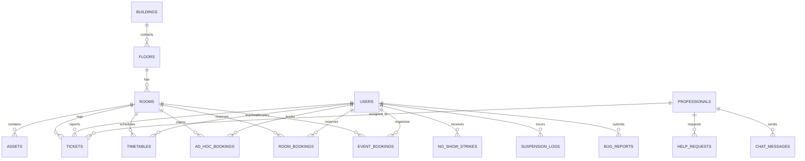
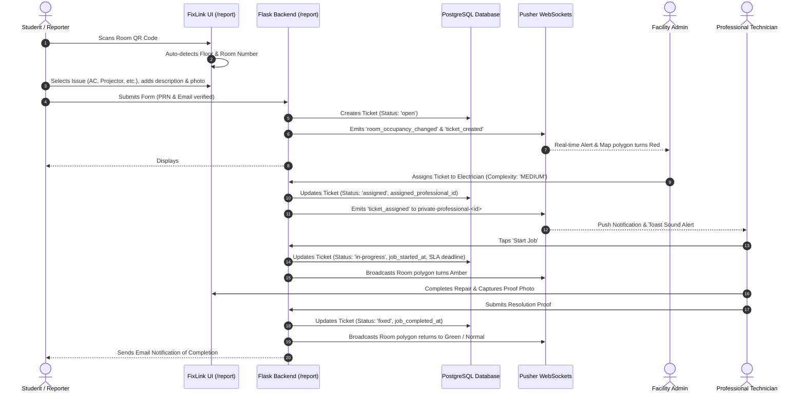

# FixLink — Comprehensive Technical & System Documentation
**MIT-WPU Vyas Building Digital Twin & Smart Campus Facility Management System**

---

## 1. Executive Summary & Project Purpose

### 1.1 What is FixLink?
**FixLink** is an enterprise-grade campus facility management platform and interactive 2D Vector Digital Twin engineered specifically for the **Vyas Building** at **Dr. Vishwanath Karad MIT World Peace University (MIT-WPU)** in Pune, Maharashtra, India. 

The Vyas Building is a multi-story academic facility (Ground Floor through 7th Floor) housing classrooms, advanced computer laboratories, faculty lounges, conference halls, meeting suites, washrooms, and elevator cores. FixLink transitions campus operations from archaic physical paper registers and fragmented email complaints to an interactive, real-time cyber-physical interface.

### 1.2 Core Mission & Objectives
1. **Accelerate Maintenance Resolution**: Replace slow, manual fault reporting with instant QR-code room detection, automated ticket classification, and real-time technician dispatching with SLA countdown timers.
2. **Live Digital Twin Visibility**: Render multi-floor vector architectural maps that visually reflect room occupancy, active incidents, and maintenance statuses in real time.
3. **Frictionless Academic Scheduling**: Enable faculty members to view personal timetables, book vacant classrooms or meeting rooms on an ad-hoc basis with automated clash prevention, and synchronize master academic schedules via CSV.
4. **Automated Accountability ("Ghost Protocol")**: Enforce classroom check-ins to eliminate "ghost bookings" where reserved classrooms remain empty, automatically releasing abandoned rooms and penalizing repeat offenders through a 3-strike policy.
5. **Analytical Operational Intelligence**: Equip campus administrators with metrics on Mean Time to Resolution (MTTR), SLA compliance percentages, equipment breakdown trends, and technician workloads.

### 1.3 Key Personas & Stakeholders

| Persona | Role & Core Needs | Primary Interface Touchpoints |
| :--- | :--- | :--- |
| **Students & Campus Visitors** | Fast, zero-friction reporting of broken assets (projectors, ACs, lights, hygiene issues) without complex signups. | Entrance QR codes, `/report`, Ticket Tracking (`/track`), Bug Report modal. |
| **Faculty Members** | Timetable management, claiming vacant classrooms for extra sessions, booking conference rooms, requesting student room swaps. | Faculty Portal (`/faculty`), Interactive Agenda, Classroom Map, Meeting Room Panel. |
| **Maintenance Technicians (Professionals)** | Field work order tracking, job timer initiation, job complexity classification, backup assistance requests, completion proof uploads. | Professional Dashboard (`/professional/dashboard`), Task Detail modal, Camera upload. |
| **Facility Administrators** | Complete building oversight, technician dispatch, live status map monitoring, timetable approvals, SLA audit reporting. | Admin Dashboard (`/admin`), Live Status Map (`/admin/map`), Asset Manager, Timetable Importer. |
| **Super Administrators / Developers** | System health diagnostics, telemetry, bug report triage, database migrations, security audits, root user authority. | Super Admin Developer Console (`/superadmin`, `/developer`). |

---

## 2. System Architecture & Design Philosophy

### 2.1 High-Level Architecture

FixLink is built using a **Modular Flask Application Factory** backend paired with a **High-Performance Vanilla Modern Web Frontend** utilizing inline SVG vector schematics, local Bootstrap 5 utilities, and Pusher WebSocket channels for real-time bidirectional synchronization.

```
+---------------------------------------------------------------------------------------+
|                                    Client Browser                                     |
|  - Semantic HTML5 (Jinja2 Templates)        - Native Vanilla JS ES Modules             |
|  - Custom CSS Design System (Dual Theme)    - Interactive SVG Digital Twin Maps       |
|  - Touch Engine (Pinch-Zoom / Drag Pan)     - Pusher JS WebSocket Client (v8.0)       |
+-------------------------------------------+-------------------------------------------+
                                            |
                                            | HTTPS / WSS
                                            v
+---------------------------------------------------------------------------------------+
|                            Web Server / Reverse Proxy Layer                           |
|       - Vercel Serverless Functions WSGI Handler (`api/index.py`)                     |
|       - Production Gunicorn WSGI Worker (`run.py` / `Dockerfile`)                      |
+-------------------------------------------+-------------------------------------------+
                                            |
                                            v
+---------------------------------------------------------------------------------------+
|                                Flask 3.0 Core Engine                                  |
|  - Application Factory Pattern (`create_app()`)                                       |
|  - Blueprints: main, admin, auth, faculty, professional, superadmin, onboarding       |
|  - Security: Flask-WTF (CSRF), OWASP Session Lockdown, Rate-Limiting                  |
|  - Background Engine: APScheduler (Ghost Protocol sweeps & SLA breach escalations)    |
|  - Cache Layer: Flask-Caching (SVG floor map memoization & query caching)             |
+---------------------+-------------------------------------------+---------------------+
                      |                                           |
                      | SQLAlchemy 2.0 ORM                        | Pusher HTTP REST API
                      v                                           v
+-------------------------------------------+   +---------------------------------------+
|             Database Engine               |   |        Pusher Channels Cloud          |
|  - PostgreSQL (Supabase / Neon DB)        |   |  - Channels: public-room-updates,     |
|    with Serverless `NullPool`             |   |    private-professional-<id>,         |
|  - SQLite 3 fallback (`fixlink.db`)       |   |    admin-notifications                |
+-------------------------------------------+   +---------------------------------------+
```

### 2.2 Blueprint Architecture & Modular Organization

The backend is strictly divided into specialized Flask Blueprints:

1. **`main` (`/`)**: Public routes. Handles landing page, QR code resolution, public issue reporting (`/report`), ticket tracking (`/track`), live map viewer (`/map`), and global bug report submission (`/api/bug-report`).
2. **`auth` (`/auth`)**: Centralized authentication for Students, Faculty, Admins, and Professionals. Supports credential verification, password reset tokens, logout workflows, and session anchoring.
3. **`admin` (`/admin`)**: Facility administrative operations. Live status map, technician assignment, ticket resolution reviews, asset management, faculty timetable CSV ingestion, event approval, and maintenance analytics.
4. **`faculty` (`/faculty`)**: Faculty operations. Weekly timetable calendar, ad-hoc classroom reservations, meeting/conference room bookings, Ghost Protocol check-ins, event booking requests, and hallway de-escalator nudges.
5. **`professional` (`/professional`)**: Technician portal. Task queue, job complexity selection (Low, Medium, High), live SLA countdown timers, technician-to-technician backup help requests, and resolution photo capture.
6. **`superadmin` (`/superadmin` & `/developer`)**: System telemetry, bug report triage, bulk resolution/deletion, user role management, database inspection, and root developer whitelisting.
7. **`onboarding` (`/onboarding`)**: Compliance gateway. Mandatory terms and conditions interceptor ensuring all authenticated users accept policy guidelines before accessing internal tools.

### 2.3 Core Design Principles
* **Vanilla Web Superiority**: Zero Tailwind CSS and zero heavyweight frontend frameworks (React, Vue, Next.js). Pure Vanilla CSS and ES Module JavaScript ensure zero build-step overhead, instant page loads, and long-term maintainability.
* **Pure SVG Digital Twin**: Vector floor plans dynamically injected into the DOM, stripped of hardcoded inline styling, allowing dynamic CSS class binding (`.interactive-room`, `.classroom`, `.lab`, `.has-issue`, `.in-progress`).
* **Mobile-First Responsiveness**: Complete touch gesture engine (two-finger pinch-to-zoom from 0.6x to 4.5x, drag panning, double-tap zoom toggle) optimized down to 360px viewport widths.
* **Dual Theme Design System**: Curated color palettes with complete dark mode compatibility (deep OLED `#0F1117` background, low-opacity 15% SVG glows, translucent card depth) toggled seamlessly without jarring page reloads.
* **Lighthouse Optimization**: Targeted $\ge 95$ Core Web Vitals score, First Contentful Paint (FCP) $\le 1.5$s, and Largest Contentful Paint (LCP) $\le 2.5$s.

---

## 3. Technology Stack Breakdown

### 3.1 Backend Core
* **Language**: Python `3.11+` / `3.14`
* **Web Framework**: Flask `3.0.x`
* **WSGI Toolkit**: Werkzeug `3.0.x`
* **ORM & Database Toolkit**: Flask-SQLAlchemy `3.1.x` / SQLAlchemy `2.0.x`
* **Migrations**: Flask-Migrate `4.0.x` (Alembic)
* **Form & CSRF Security**: Flask-WTF `1.2.x`
* **Background Scheduling**: APScheduler `3.10.x`
* **Caching**: Flask-Caching `2.1.x`
* **Environment Configuration**: `python-dotenv`

### 3.2 Database Engine
* **Production Database**: PostgreSQL (Hosted on Supabase / Neon Serverless PostgreSQL)
  * Serverless optimization: Utilizes `NullPool` connection pooling in serverless environments (Vercel) to eliminate connection exhaustion during traffic bursts.
  * Collation & Queries: Uses strict type casting and `func.lower()` queries for case-insensitive credential lookups.
* **Local Development & Testing**: SQLite 3 (`fixlink.db` or in-memory `:memory:`) with automated schema creation and table inspection.

### 3.3 Real-Time & Communications
* **WebSockets**: Pusher Channels (`pusher>=3.3.0` server library, `pusher-js 8.0.1` client library).
  * Real-time events: `room_occupancy_changed`, `ticket_assigned`, `ticket_updated`, `help_requested`, `faculty_nudge`.
* **Push Notifications**: `pywebpush 2.0.x` implementing the VAPID Web Push protocol for background browser notifications.
* **Email Dispatch**: EmailJS integration with SMTP fallback.
* **Document Processing**: `fpdf2` for automated PDF maintenance audit reports, `qrcode` for QR code vector/raster generation, and `pandas` for timetable CSV parsing.

### 3.4 Frontend Stack
* **Markup**: Semantic HTML5 with Jinja2 template inheritance (`base.html`).
* **Styling**: Native CSS3 with CSS Custom Properties (`:root` and `[data-bs-theme="dark"]`), local Bootstrap `5.3.x` utility classes, custom component sheets (`style.min.css`, `faculty_dashboard.min.css`).
* **JavaScript**: Vanilla ES6+ Modules (`app/static/js/modules/`):
  * `main.js`: Core entry point, theme management, mobile navigation, global alerts.
  * `api.js`: Standardized `fetch()` wrapper handling CSRF tokens, error parsing, and session recovery.
  * `render.js`: SVG Digital Twin renderer, path styling, room label attaching, glow filters.
  * `ui.js`: Touch gestures (pinch-zoom, pan), room modal controls, offcanvas drawers.
  * `admin_map.js`: Admin-specific live map interactions, quick technician dispatching.
* **Animations & Alerts**: GreenSock Animation Platform (GSAP 3.x), SweetAlert2 (`swal2`).
* **Iconography**: Bootstrap Icons `1.11.x` vector font icons.

---

## 4. Complete Database Schema & Models

### 4.1 Entity Relationship Diagram



### 4.2 Comprehensive Model Specifications

#### 1. `User` (`users`)
Represents all authenticated campus actors (Students, Faculty, Staff, Admins, Super Admins).
* `id` (Integer, PK)
* `name` (String(100), Nullable=False)
* `email` (String(120), Unique=True, Nullable=False) — Case-insensitively indexed.
* `prn` (String(20), Nullable=True) — Permanent Registration Number for MIT-WPU students.
* `password_hash` (String(255), Nullable=False) — PBKDF2-SHA256 encrypted.
* `role` (String(20), Default='student') — Options: `student`, `faculty`, `staff`, `admin`.
* `is_admin` (Boolean, Default=False)
* `is_verified` (Boolean, Default=False)
* `has_accepted_terms` (Boolean, Default=False) — Mandatory onboarding terms acceptance.
* `adhoc_suspended_until` (DateTime, Nullable=True) — Ghost Protocol lockout deadline.
* `adhoc_suspension_reason` (String(255), Nullable=True)
* `created_at` (DateTime, Default=UTC Now)
* *Key Properties*: `is_adhoc_suspended`, `suspension_remaining_str`, `active_strikes_count`.

#### 2. `NoShowStrike` (`no_show_strikes`)
Tracks automated no-show strikes issued under Ghost Protocol.
* `id` (Integer, PK)
* `faculty_id` (Integer, FK -> `users.id`, Nullable=False)
* `booking_id` (Integer, Nullable=True)
* `booking_type` (String(20), Default='adhoc') — `adhoc` or `room_booking`.
* `room_number` (String(20), Nullable=False)
* `slot_time` (String(50), Nullable=False)
* `reason` (String(255), Default='No check-in within 10 minutes of start time')
* `created_at` (DateTime, Default=UTC Now)
* `is_active` (Boolean, Default=True) — Evaluated within a 30-day rolling window.

#### 3. `SuspensionLog` (`suspension_logs`)
Maintains historical records of faculty booking privilege suspensions.
* `id` (Integer, PK)
* `faculty_id` (Integer, FK -> `users.id`, Nullable=False)
* `strikes_count` (Integer, Default=3)
* `suspended_at` (DateTime, Default=UTC Now)
* `suspended_until` (DateTime, Nullable=False)
* `reason` (String(255))
* `is_active` (Boolean, Default=True)

#### 4. `Building` (`buildings`)
Physical campus structure metadata.
* `id` (Integer, PK)
* `name` (String(100), Nullable=False) — e.g., "Vyas Building".
* `description` (Text, Nullable=True)
* `created_at` (DateTime, Default=UTC Now)

#### 5. `Floor` (`floors`)
Building floor level configurations.
* `id` (Integer, PK)
* `building_id` (Integer, FK -> `buildings.id`, Nullable=False)
* `level` (Integer, Nullable=False) — Levels 0 through 7.
* `name` (String(50), Nullable=False) — e.g., "4th Floor".
* `svg_path` (String(255), Nullable=True) — Filepath to static vector SVG schematic.
* `created_at` (DateTime, Default=UTC Now)

#### 6. `Room` (`rooms`)
Individual rooms, laboratories, and physical spaces on a floor.
* `id` (Integer, PK)
* `floor_id` (Integer, FK -> `floors.id`, Nullable=False)
* `number` (String(20), Nullable=False) — e.g., "VY401", "MR4", "VY001".
* `name` (String(100), Nullable=True) — e.g., "Computer Lab 401".
* `room_type` (String(50), Default='class') — `class`, `lab`, `washroom`, `faculty`, `lift`, `kitchen`, `canteen`, `encave`, `conference`, `meeting`, `unavailable`.
* `status` (String(20), Default='normal') — `normal`, `issue`, `in-progress`, `assigned`.
* `created_at` (DateTime, Default=UTC Now)
* *Key Properties*:
  * `current_occupancy_status`: Complex dictionary evaluating active `RoomBooking`, `EventBooking`, and `Timetable` records for the current hour.
  * `has_open_tickets`: Boolean indicating active unresolved issues.
  * `time_until_next_lecture`: Returns remaining duration until the next scheduled academic session.

#### 7. `Asset` (`assets`)
Physical fixtures, hardware, and equipment mapped to a room.
* `id` (Integer, PK)
* `room_id` (Integer, FK -> `rooms.id`, Nullable=False)
* `asset_type` (String(50), Nullable=False) — e.g., `AC`, `Projector`, `PC`, `Light`, `Bench`.
* `identifier` (String(50), Nullable=True) — e.g., "PRJ-01", "AC-NORTH".
* `status` (String(20), Default='working') — `working`, `maintenance`, `broken`.

#### 8. `Ticket` (`tickets`)
Maintenance work orders and problem incident reports.
* `id` (Integer, PK)
* `room_id` (Integer, FK -> `rooms.id`, Nullable=False)
* `asset_id` (Integer, FK -> `assets.id`, Nullable=True)
* `assigned_professional_id` (Integer, FK -> `professionals.id`, Nullable=True)
* `issue_type` (String(50), Nullable=False)
* `description` (Text, Nullable=False)
* `image_filename` (String(255), Nullable=True)
* `complexity` (String(20), Default='MEDIUM') — `LOW`, `MEDIUM`, `HIGH`.
* `time_limit_hours` (Float, Default=24.0) — SLA resolution window.
* `deadline_datetime` (DateTime, Nullable=True)
* `job_started_at` (DateTime, Nullable=True)
* `job_completed_at` (DateTime, Nullable=True)
* `completion_photo_filename` (String(255), Nullable=True)
* `cancellation_reason` (Text, Nullable=True)
* `status` (String(20), Default='open') — `open`, `assigned`, `in-progress`, `fixed`, `cancelled`.
* `reporter_id` (Integer, FK -> `users.id`, Nullable=True)
* `reporter_name` (String(100), Nullable=True)
* `reporter_email` (String(120), Nullable=True)
* `prn` (String(20), Nullable=True)
* `rating` (Integer, Nullable=True) — 1 to 5 star rating.
* `rating_comment` (Text, Nullable=True)
* *Key Properties*: `is_overdue`, `sla_progress_percentage`, `time_remaining_seconds`.

#### 9. `Professional` (`professionals`)
Skilled maintenance technicians responsible for resolving tickets.
* `id` (Integer, PK)
* `name` (String(100), Nullable=False)
* `email` (String(120), Unique=True, Nullable=False)
* `category` (String(50), Nullable=False) — `Electrician`, `Plumber`, `IT/AV Tech`, `HVAC`, `Carpenter`.
* `phone` (String(20), Nullable=False)
* `password_hash` (String(255), Nullable=False)
* `is_available` (Boolean, Default=True)
* `rating` (Float, Default=5.0)
* `tasks_completed` (Integer, Default=0)

#### 10. `HelpRequest` (`help_requests`)
Technician-to-technician collaboration requests.
* `id` (Integer, PK)
* `ticket_id` (Integer, FK -> `tickets.id`, Nullable=False)
* `requester_id` (Integer, FK -> `professionals.id`, Nullable=False)
* `reason` (Text, Nullable=False)
* `status` (String(20), Default='pending') — `pending`, `accepted`, `cancelled`.
* `created_at` (DateTime, Default=UTC Now)

#### 11. `ChatMessage` (`chat_messages`)
Direct communication between Admins and Technicians.
* `id` (Integer, PK)
* `sender_id` (Integer, Nullable=False)
* `sender_type` (String(20), Nullable=False) — `admin` or `professional`.
* `receiver_id` (Integer, Nullable=False)
* `receiver_type` (String(20), Nullable=False)
* `message` (Text, Nullable=False)
* `is_read` (Boolean, Default=False)
* `created_at` (DateTime, Default=UTC Now)

#### 12. `Notification` (`notifications`)
In-app notification records for dashboard bells and toasts.
* `id` (Integer, PK)
* `user_id` (Integer, FK -> `users.id`, Nullable=True)
* `title` (String(100), Nullable=False)
* `message` (Text, Nullable=False)
* `type` (String(20), Default='info') — `info`, `warning`, `success`, `error`, `chat`.
* `link` (String(255), Nullable=True)
* `is_read` (Boolean, Default=False)
* `created_at` (DateTime, Default=UTC Now)

#### 13. `PushSubscription` (`push_subscriptions`)
Browser push notification endpoints (VAPID).
* `id` (Integer, PK)
* `user_id` (Integer, FK -> `users.id`, Nullable=True)
* `professional_id` (Integer, FK -> `professionals.id`, Nullable=True)
* `endpoint` (Text, Nullable=False)
* `p256dh` (Text, Nullable=False)
* `auth` (Text, Nullable=False)
* `created_at` (DateTime, Default=UTC Now)

#### 14. `AdHocBooking` (`adhoc_bookings`)
Instant room claims initiated by faculty members.
* `id` (Integer, PK)
* `room_id` (Integer, FK -> `rooms.id`, Nullable=False)
* `faculty_id` (Integer, FK -> `users.id`, Nullable=False)
* `subject` (String(100), Nullable=False)
* `start_datetime` (DateTime, Nullable=False) — UTC.
* `end_datetime` (DateTime, Nullable=False) — UTC.
* `checked_in` (Boolean, Default=False)
* `checked_in_at` (DateTime, Nullable=True)
* `created_at` (DateTime, Default=UTC Now)

#### 15. `Timetable` (`timetables`)
Recurring weekly master academic timetable.
* `id` (Integer, PK)
* `faculty_id` (Integer, FK -> `users.id`, Nullable=True)
* `collaborator_id` (Integer, FK -> `users.id`, Nullable=True)
* `room_id` (Integer, FK -> `rooms.id`, Nullable=False)
* `day_of_week` (Integer, Nullable=False) — 0 = Monday through 5 = Saturday.
* `start_time` (Time, Nullable=False) — e.g., `09:00:00`.
* `end_time` (Time, Nullable=False) — e.g., `10:00:00`.
* `subject` (String(100), Nullable=False)
* `division` (String(50), Nullable=True)
* `course` (String(100), Nullable=True)
* `academic_term` (String(50), Default='AY 2026-27 Sem 1')

#### 16. `RoomBooking` (`room_bookings`)
Specific slot-based classroom and meeting room reservations.
* `id` (Integer, PK)
* `room_id` (Integer, FK -> `rooms.id`, Nullable=False)
* `faculty_id` (Integer, FK -> `users.id`, Nullable=False)
* `date` (Date, Nullable=False)
* `slot_start` (DateTime, Nullable=False)
* `status` (String(20), Default='active') — `active`, `cancelled`.
* `subject` (String(100), Nullable=True)
* `division` (String(50), Nullable=True)
* `course` (String(100), Nullable=True)
* `checked_in` (Boolean, Default=False)
* `checked_in_at` (DateTime, Nullable=True)
* `created_at` (DateTime, Default=UTC Now)

#### 17. `EventBooking` (`event_bookings`)
Multi-room, multi-day university event reservations requiring admin approval.
* `id` (Integer, PK)
* `title` (String(150), Nullable=False)
* `description` (Text, Nullable=True)
* `faculty_id` (Integer, FK -> `users.id`, Nullable=False)
* `start_date` (Date, Nullable=False)
* `end_date` (Date, Nullable=False)
* `start_time` (Time, Nullable=False)
* `end_time` (Time, Nullable=False)
* `status` (String(20), Default='Pending') — `Pending`, `Approved`, `Rejected`, `Cancelled`.
* `admin_notes` (Text, Nullable=True)
* `reviewed_by_id` (Integer, FK -> `users.id`, Nullable=True)
* `reviewed_at` (DateTime, Nullable=True)
* `created_at` (DateTime, Default=UTC Now)
* `rooms` (ManyToMany relationship via `event_rooms` join table).

#### 18. `ScheduleSubmission` (`schedule_submissions`)
Staging table for visual faculty timetable CSV submissions pending bulk approval.
* `id` (Integer, PK)
* `faculty_id` (Integer, FK -> `users.id`, Nullable=False)
* `status` (String(20), Default='pending') — `draft`, `pending`, `approved`, `rejected`.
* `academic_term` (String(50), Default='AY 2026-27 Sem 1')
* `total_hours` (Integer, Default=0)
* `schedule_data` (JSON, Nullable=False)
* `admin_notes` (Text, Nullable=True)
* `submitted_at` (DateTime, Default=UTC Now)

#### 19. `BugReport` (`bug_reports`)
User feedback, visual glitch logs, and defect submissions.
* `id` (Integer, PK)
* `title` (String(150), Nullable=False)
* `description` (Text, Nullable=False)
* `file_path` (String(255), Nullable=True)
* `file_data` (LargeBinary, Nullable=True) — Embedded image data backup.
* `status` (String(20), Default='open') — `open`, `in_progress`, `resolved`, `closed`.
* `reporter_id` (Integer, Nullable=True)
* `reporter_type` (String(50), Nullable=True) — `student`, `faculty`, `admin`, `professional`.
* `created_at` (DateTime, Default=UTC Now)

---

## 5. Core Functional Modules & Workflows

### 5.1 Interactive SVG Digital Twin
1. **Dynamic SVG Injection**: High-precision vector floor schematics (`app/static/images/floors/VY0.svg` through `VY7.svg`) are fetched and dynamically injected into the `#facultyMapContainer`.
2. **Inline Attribute Stripping**: SVG parser strips all hardcoded `fill`, `stroke`, and `style` attributes exported by graphic editors, replacing them with dynamic semantic classes:
   * `.classroom` / `.fill-blue`: Regular teaching classrooms.
   * `.lab` / `.fill-teal`: Computer science and engineering labs.
   * `.washroom` / `.fill-red`: Student & faculty restrooms.
   * `.faculty-room` / `.fill-orange`: Faculty cabins and departments.
   * `.conference-room` / `.fill-purple`: Conference facilities.
   * `.meeting-room` / `.fill-cyan`: Executive meeting spaces.
   * `.lift` / `.fill-pink`: Elevators.
3. **Pointer-Events Isolation Rule**: The root SVG document is assigned `pointer-events: none;`. Only valid room boundaries receive `pointer-events: auto;`. This eliminates phantom clicks caused by overlapping bounding boxes.
4. **Touch & Pan-Zoom Engine**: Native JavaScript touch math calculates two-finger pinch distance and translation deltas, providing 60 FPS zoom between 0.6x and 4.5x with bounded edge clamping.
5. **Flashlight Mode & Deep-Linking**: URL queries such as `/faculty/dashboard?locate=VY402` or `/admin/map?room=VY527` immediately navigate to the floor, zoom onto the target room, and execute a high-visibility GSAP spotlight pulse.

### 5.2 Maintenance Issue Reporting & Lifecycle


### 5.3 Faculty Smart Classroom Management (CMM)
1. **Operating Hours Enforcement**: Reservations are restricted to university operational hours (**7:00 AM to 7:00 PM IST**). The system strictly prevents slot start times before 07:00 or after 18:00, and rejects multi-hour slots that would conclude after 19:00.
2. **15-Minute Physical Transition Buffer**: Classroom availability calculations enforce a 15-minute physical dead zone following every scheduled session to prevent hallway bottlenecks and class changeover friction.
3. **Contiguous Slot Merging**: Two consecutive 1-hour ad-hoc bookings made by the same faculty member automatically merge on the visual agenda into a single unified block spanning 2 columns with `colspan="2"`.
4. **Hallway De-Escalator (Real-Time Nudges)**: If an instructor arrives outside an occupied room, they can click "Send Polite Nudge". FixLink dispatches an instant, courteous toast notification via Pusher to the currently lecturing professor: *"Prof. [Name] is outside preparing for the next session."*

### 5.4 Ghost Protocol (Anti-Squatting Attendance Governance)
1. **The Problem**: Faculty frequently book classrooms in advance and fail to show up, depriving other educators of vacant spaces.
2. **10-Minute Check-In Gate**: When an ad-hoc room reservation begins, the faculty member has a strict 10-minute window to tap the "Check-In" button on their dashboard.
3. **Automated Sweep**: The backend APScheduler job (`app/scheduler.py`) executes regular sweeps. Any active booking with `checked_in == False` exceeding 10 minutes past start time is automatically cancelled.
4. **Immediate Deallocation**: Room occupancy is instantly released across all digital twin maps, switching the room to vacant green.
5. **3-Strike Accountability Engine**:
   * Each no-show logs a `NoShowStrike` record linked to the faculty profile.
   * If an instructor accumulates **3 strikes within a rolling 30-day window**, their ad-hoc booking privileges are **automatically suspended for 7 days** (`adhoc_suspended_until`).
   * The UI responds by disabling quick-book buttons and rendering an active lockout countdown notice.

---

## 6. Security, Privacy & Reliability Guardrails

### 6.1 OWASP Session & Cookie Hardening
* **`SESSION_COOKIE_HTTPONLY = True`**: Blocks access to cookies from JavaScript `document.cookie`, neutralizing cross-site scripting (XSS) cookie extraction.
* **`SESSION_COOKIE_SAMESITE = 'Lax'`**: Prevents Cross-Site Request Forgery (CSRF) in cross-origin top-level navigation.
* **`PERMANENT_SESSION_LIFETIME = timedelta(hours=2)`**: Bounded session duration ensures inactive terminals automatically log out.
* **Secret Key Enforcement**: In production (Vercel/Render), `SECRET_KEY` must be explicitly defined in environment variables; missing keys abort startup to prevent session invalidation on serverless restarts.

### 6.2 CSRF Protection Lifecycle
* Every form generated via Jinja2 includes a hidden CSRF token input (`{{ csrf_token() }}`).
* All dynamic AJAX `fetch()` POST/PUT/DELETE requests read the token from `<meta name="csrf-token" content="...">` and include it in the `X-CSRFToken` HTTP header.

### 6.3 Self-Healing Authentication & Credential Integrity
* **Case-Insensitive Email Lookups**: All authentication queries compare `func.lower(User.email) == input_email.lower()` to eliminate uppercase mobile keyboard collation failures.
* **Hardcoded Root Administrator Whitelist**: Super administrators (`taha.piplodwala@mitwpu.edu.in`, `om.mahadik@mitwpu.edu.in`) are permanently protected in application memory.
* **Automatic Core Account Seeding**: If missing on cold start, default accounts (`admin@mitwpu.edu.in`, `bottlesingh#pro`) are automatically seeded by `init_db()` before traffic is served.

### 6.4 File Upload & Asset Security
* Uploads are capped at a strict 16MB limit via `MAX_CONTENT_LENGTH`.
* File paths are sanitized using Werkzeug's `secure_filename()`.
* Permitted extensions are strictly whitelisted: `.png`, `.jpg`, `.jpeg`, `.webp`.

---

## 7. API Specification & Endpoints Directory

### 7.1 Public & Reporting API (`main`)

| Method | Endpoint | Access | Description |
| :--- | :--- | :--- | :--- |
| `GET` | `/` | Public | Landing page with interactive digital twin map preview. |
| `GET` | `/report` | Public | Maintenance report submission form. |
| `POST` | `/report` | Public | Submits a maintenance ticket with description, issue type, PRN, and photo. |
| `GET` | `/track` | Public | Lookup status of ticket by integer ID. |
| `GET` | `/api/floors/<int:building_id>` | Public | Returns floor levels for a building. |
| `GET` | `/api/rooms/floor/<int:floor_id>` | Public | Returns cached rooms and occupancy statuses for a floor. |
| `GET` | `/api/room/<room_number>` | Public | Returns room metadata and active issue tickets. |
| `POST` | `/api/bug-report` | Public | Submits a defect or UI issue report. |

### 7.2 Authentication API (`auth`)

| Method | Endpoint | Access | Description |
| :--- | :--- | :--- | :--- |
| `POST` | `/login` | Public | Student, faculty, and admin credential authentication. |
| `GET` | `/logout` | Authenticated | Clears session data and destroys session cookie. |
| `POST` | `/forgot-password` | Public | Dispatches password reset token link via email. |
| `POST` | `/reset-password/<token>` | Public | Resets user password upon valid token presentation. |
| `GET` | `/api/auth/status` | Public | Returns JSON `{ "authenticated": bool, "role": str }`. |

### 7.3 Facility Administration API (`admin`)

| Method | Endpoint | Access | Description |
| :--- | :--- | :--- | :--- |
| `GET` | `/admin` | Admin | Main administrative dashboard. |
| `GET` | `/admin/map` | Admin | Real-time interactive administration floor map. |
| `GET` | `/admin/floor-data/<int:floor_id>` | Admin | Returns comprehensive room, asset, and active ticket payloads. |
| `POST` | `/admin/api/ticket/<int:id>/assign` | Admin | Assigns a professional technician and complexity tier to a ticket. |
| `POST` | `/admin/api/timetable/import-csv` | Admin | Commits department master timetable CSV to database. |
| `POST` | `/admin/api/timetable/delete` | Admin | Deletes specific scheduled lecture block. |
| `GET` | `/admin/api/analytics/summary` | Admin | Returns MTTR, SLA compliance rates, and fault distributions. |

### 7.4 Faculty Operations API (`faculty`)

| Method | Endpoint | Access | Description |
| :--- | :--- | :--- | :--- |
| `GET` | `/faculty/dashboard` | Faculty | Faculty dashboard with schedule calendar and smart classroom map. |
| `POST` | `/faculty/api/bookings/create` | Faculty | Reserves 1-hour or 2-hour classroom slot with conflict checks. |
| `POST` | `/faculty/api/claim-room` | Faculty | Instant ad-hoc claim of an empty classroom. |
| `POST` | `/faculty/api/bookings/<int:id>/check_in` | Faculty | Performs mandatory Ghost Protocol check-in. |
| `POST` | `/faculty/api/bookings/cancel/<int:id>` | Faculty | Cancels a classroom slot reservation. |
| `GET` | `/faculty/api/meeting-rooms` | Faculty | Returns available conference and meeting rooms on Floors 0 & 6. |
| `POST` | `/faculty/api/meeting-rooms/book` | Faculty | Reserves a meeting or conference room. |
| `POST` | `/faculty/api/rooms/<int:id>/nudge` | Faculty | Emits a real-time hallway de-escalator nudge to the current occupant. |
| `POST` | `/faculty/events/create` | Faculty | Submits a multi-room campus event booking request for admin review. |

### 7.5 Technician (Professional) API (`professional`)

| Method | Endpoint | Access | Description |
| :--- | :--- | :--- | :--- |
| `GET` | `/professional/dashboard` | Professional | Technician work order queue and active job console. |
| `POST` | `/professional/api/task/<int:id>/start` | Professional | Starts technician work timer and sets complexity. |
| `POST` | `/professional/api/task/<int:id>/complete` | Professional | Uploads completion photo proof and marks ticket fixed. |
| `POST` | `/professional/api/task/<int:id>/request-help` | Professional | Broadcasts backup request to fellow technicians. |
| `POST` | `/professional/api/task/<int:id>/cancel` | Professional | Cancels assigned task with reason for admin re-routing. |

---

## 8. Deployment, Environment Configuration & Setup

### 8.1 Environment Variables Reference (`.env`)

| Variable | Required | Default | Description |
| :--- | :---: | :--- | :--- |
| `SECRET_KEY` | **Yes** | Generated | Secret key for signing session cookies and CSRF tokens. |
| `DATABASE_URL` | **Yes** | `sqlite:///fixlink.db` | PostgreSQL connection string (`postgresql://...`) or SQLite URL. |
| `FLASK_ENV` | No | `production` | Environment mode (`development` or `production`). |
| `FLASK_DEBUG` | No | `False` | Enables verbose stack traces on API errors when `True`. |
| `PUSHER_APP_ID` | Optional | `None` | Pusher application identifier for real-time WebSockets. |
| `PUSHER_KEY` | Optional | `None` | Pusher public API key. |
| `PUSHER_SECRET` | Optional | `None` | Pusher private API secret. |
| `PUSHER_CLUSTER` | Optional | `ap2` | Pusher cluster zone (e.g., `ap2` for Asia Pacific - Mumbai). |
| `VAPID_PUBLIC_KEY` | Optional | `None` | Web Push VAPID public key. |
| `VAPID_PRIVATE_KEY` | Optional | `None` | Web Push VAPID private key. |
| `VAPID_CLAIM_EMAIL` | Optional | `admin@mitwpu.edu.in` | Administrative email for push delivery identification. |

### 8.2 Local Development Setup

#### Prerequisites
* Python 3.11 or higher
* Git
* SQLite 3 or PostgreSQL

#### Step-by-Step Installation
1. **Clone the repository**:
   ```bash
   git clone https://github.com/meowpher/FixLink.git
   cd FixLink
   ```

2. **Create and activate a virtual environment**:
   ```bash
   # Windows
   python -m venv venv
   .\venv\Scripts\activate

   # Linux / macOS
   python3 -m venv venv
   source venv/bin/activate
   ```

3. **Install dependencies**:
   ```bash
   pip install -r requirements.txt
   ```

4. **Configure environment variables**:
   ```bash
   cp .env.example .env
   # Edit .env to supply your SECRET_KEY and DATABASE_URL
   ```

5. **Initialize Database & Run Application**:
   ```bash
   python run.py
   ```
   *The server will start at `http://localhost:5000`.*
   *Database tables and default accounts are automatically created and seeded on initial boot.*

### 8.3 Running Automated Tests
FixLink features a comprehensive Pytest test suite covering authentication, RBAC, timetable import, operating hours boundary enforcement, Ghost Protocol strikes, and ticket lifecycles.

```bash
# Run complete test suite
pytest

# Run with verbose output and coverage
pytest -v
```
*Current test status: **63 passed** across all suites.*

### 8.4 Docker Deployment
FixLink includes production-ready container configurations:

```bash
# Build the Docker image
docker build -t fixlink:latest .

# Run container with environment bindings
docker run -d -p 5000:5000 --env-file .env --name fixlink-app fixlink:latest
```

Using Docker Compose:
```bash
docker-compose up -d
```

---

## 9. Repository Directory Map

```
FixLink/
├── .env.example                 # Environment variable template
├── Dockerfile                   # Production container definition
├── docker-compose.yml           # Multi-container orchestration
├── pytest.ini                   # Pytest configuration and testpaths
├── requirements.txt             # Python package dependencies
├── run.py                       # Local application development runner
├── vercel.json                  # Vercel serverless deployment routing
│
├── api/
│   └── index.py                 # Vercel Serverless WSGI entrypoint wrapper
│
├── app/
│   ├── __init__.py              # Application Factory (`create_app`), middleware
│   ├── database.py              # Engine setup, `init_db()`, seed data
│   ├── models.py                # Complete SQLAlchemy ORM model definitions (19 models)
│   ├── decorators.py            # RBAC guards (@admin_required, @faculty_login_required)
│   ├── api_utils.py             # Standardized JSON response & error handling wrappers
│   ├── realtime.py              # Pusher Channels event dispatching utilities
│   ├── scheduler.py             # APScheduler jobs (Ghost Protocol & SLA sweeps)
│   ├── sla_service.py           # SLA calculation matrix & countdown trackers
│   ├── analytics.py             # MTTR, SLA compliance, and failure rate metrics
│   ├── cache.py                 # Floor plan memoization & cache invalidation
│   ├── spam_detector.py         # Anti-spam heuristic filters for public reporting
│   ├── utils.py                 # QR generators, PDF generators, VAPID push utilities
│   │
│   ├── blueprints/              # Modular application route blueprints
│   │   ├── admin/               # Administrative portal routes & endpoints
│   │   ├── auth/                # Login, registration, password recovery
│   │   ├── faculty/             # Faculty agenda, booking, Ghost Protocol check-in
│   │   ├── main/                # Public reporting, tracking, live map viewer
│   │   ├── onboarding/          # Mandatory Terms of Service compliance
│   │   ├── professional/        # Technician work order console
│   │   └── superadmin/          # Developer telemetry & bug triage console
│   │
│   ├── static/                  # Static assets
│   │   ├── css/                 # Vanilla stylesheets (`style.min.css`, `faculty_dashboard.min.css`)
│   │   ├── js/
│   │   │   ├── main.js          # Core frontend coordinator
│   │   │   └── modules/         # ES6 modules (`api.js`, `render.js`, `ui.js`, `admin_map.js`)
│   │   └── images/
│   │       └── floors/          # Architectural vector SVGs (VY0.svg - VY7.svg)
│   │
│   └── templates/               # Jinja2 HTML templates
│       ├── base.html            # Universal layout shell with navigation
│       ├── report.html          # Public fault reporting page
│       ├── track.html           # Public ticket progress tracker
│       ├── status_map.html      # Full-screen interactive map
│       ├── admin/               # Admin dashboards & management templates
│       ├── faculty/             # Faculty portal & classroom timetable view
│       ├── professional/        # Technician job execution console
│       └── superadmin/          # Developer telemetry dashboard
│
└── tests/                       # Pytest test suite (63 automated tests)
    ├── conftest.py              # In-memory SQLite fixtures & mock services
    ├── test_auth.py             # Authentication & session lockdown tests
    ├── test_meeting_room_booking.py # Booking boundary & string ID coercion tests
    ├── test_ticket_lifecycle.py # Ticket dispatch, SLA, and completion tests
    ├── test_timetable_sanitizer.py  # CSV timetable parser validation tests
    ├── test_bulk_assign.py      # Technician batch dispatch tests
    ├── test_analytics.py        # MTTR & SLA compliance calculation tests
    └── test_rule7_verification.py   # Security invariant & guardrail test suite
```

---

## 10. Summary & System Invariants

FixLink embodies a zero-compromise approach to educational institution facility management:
* **Zero Data Loss**: Core system accounts auto-heal upon startup with case-insensitive collision guards.
* **Zero Phantom Bookings**: The combination of physical 15-minute transition dead zones and the 10-minute Ghost Protocol check-in guarantees that classroom availability on screen directly matches physical campus reality.
* **Zero Bloat**: Free of unneeded framework weight, FixLink proves that pure HTML5, modern vanilla CSS, modular ES6 JavaScript, and Python Flask can deliver a desktop and mobile digital twin experience that is responsive, secure, and lightning fast.
 